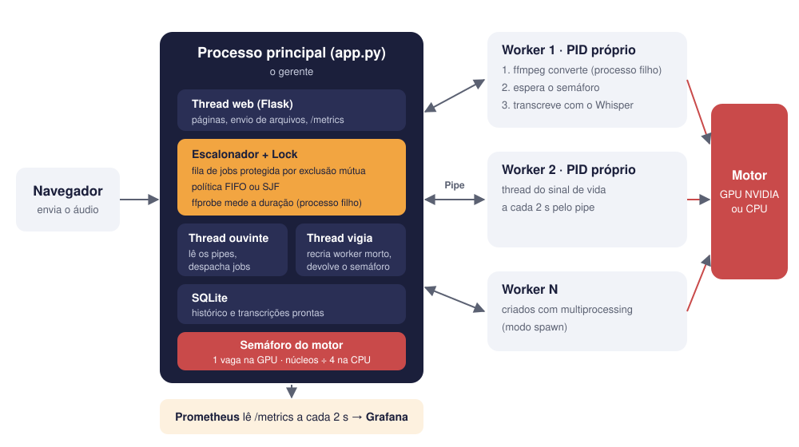

# Transcritor

Transcrição de áudio e vídeo **no seu próprio computador**, para jornalistas e quem mais grava entrevistas. Nada sai da máquina: o arquivo não vai para nenhum serviço na internet.

O app vê sozinho o que o computador tem (sistema, núcleos, memória, placa de vídeo NVIDIA), mostra quais modelos de transcrição cabem nele, baixa o recomendado e transcreve na GPU, se houver, ou na CPU. O resultado sai com marcação de tempo, em TXT ou em SRT (legenda).

Projeto final de **Sistemas Operacionais** (ADS, UniSENAC). Os conceitos da disciplina estão no próprio código: [veja abaixo](#conceitos-de-sistemas-operacionais).



## Como rodar

### Com Docker (Linux, Windows ou Mac)

Precisa do [Docker](https://docs.docker.com/get-docker/) (no Windows e no Mac, o Docker Desktop).

```bash
docker compose up -d --build
```

Abra <http://localhost:5000>. Na primeira vez, o app baixa sozinho o modelo recomendado.

**Com placa NVIDIA** (Linux, ou Windows com WSL 2), instale o [NVIDIA Container Toolkit](https://docs.nvidia.com/datacenter/cloud-native/container-toolkit/latest/install-guide.html) e suba com a camada de GPU:

```bash
docker compose -f docker-compose.yml -f docker-compose.gpu.yml up -d --build
```

### Direto no computador, sem Docker

Precisa do Python 3.10 a 3.12 (testado no 3.12) e do [ffmpeg](https://ffmpeg.org/download.html) no PATH.

```bash
python -m venv .venv
# Linux e Mac
source .venv/bin/activate
# Windows
.venv\Scripts\activate

pip install -r requirements.txt
# só com placa NVIDIA:
pip install -r requirements-gpu.txt

python app.py
```

### Monitoramento (Grafana)

Para ver os processos trabalhando ao vivo, suba também o Prometheus e o Grafana:

```bash
docker compose -f docker-compose.yml -f docker-compose.monitor.yml up -d --build
```

Junte o `-f docker-compose.gpu.yml` se for usar a GPU. O painel fica em <http://localhost:3000>, sem login. Se o app estiver rodando direto no computador, sem Docker, suba só o monitoramento: `docker compose -f docker-compose.monitor.yml up -d`.

### Ajustes

Por variável de ambiente (no Docker, num arquivo `.env` ao lado do compose):

| Variável | Padrão | O que faz |
|---|---|---|
| `WORKERS` (`TRANSCRITOR_WORKERS` sem Docker) | 3 | Quantos processos worker |
| `POLITICA` (`TRANSCRITOR_POLITICA`) | `fifo` | Escalonamento: `fifo` ou `sjf` (também troca pela página) |
| `DISPOSITIVO` (`TRANSCRITOR_DISPOSITIVO`) | `auto` | `auto`, `cpu` ou `cuda` |
| `TRANSCRITOR_VAGAS` | 1 na GPU; núcleos ÷ 4 na CPU | Quantos workers podem estar no motor ao mesmo tempo (semáforo) |
| `PORTA` / `PORTA_GRAFANA` | 5000 / 3000 | Portas no Docker |

## Demonstração

Com o app no ar, rode os scripts da pasta [`demo/`](demo). Só precisam do Python, sem nenhuma biblioteca extra:

```bash
cd demo
python 1_concorrencia.py      # 6 áudios ao mesmo tempo: cada job é pego por um único worker
python 2_falha.py             # mata um worker no meio do job: o job volta para a fila e termina
python 3_escalonamento.py     # FIFO contra SJF: o efeito comboio e o tempo médio de espera
```

Para apontar para outro endereço: `TRANSCRITOR_URL=http://outra-maquina:5000 python 1_concorrencia.py`.

O áudio de teste ([`demo/amostras/fala.wav`](demo/amostras/fala.wav)) é o discurso de posse de John F. Kennedy (1961), de domínio público. Os scripts o repetem para criar áudios mais longos.

## Conceitos de Sistemas Operacionais

| Conceito | Onde está |
|---|---|
| **Processos** | Cada worker é um processo próprio (`multiprocessing`, modo `spawn`), com PID e memória separados: [gerente.py](transcritor/gerente.py) |
| **Comunicação entre processos** | Um `Pipe` para cada worker: o gerente manda o job, o worker devolve estado, progresso e resultado: [worker.py](transcritor/worker.py) |
| **Threads e exclusão mútua** | No gerente, as threads da web, do ouvinte e do vigia mexem na mesma fila, protegida por um `Lock`. No worker, a thread do sinal de vida e a principal dividem o mesmo `Pipe`, também com `Lock` |
| **Semáforo** | Um `BoundedSemaphore` limita quantos workers usam o motor ao mesmo tempo. Na GPU, um só, porque o modelo ocupa a VRAM |
| **Escalonamento** | FIFO (ordem de chegada) ou SJF (o áudio mais curto primeiro), trocável com o app rodando: [escalonador.py](transcritor/escalonador.py) |
| **Sinais e falhas** | O vigia percebe o worker morto (ou calado há 15 s), devolve o semáforo em nome dele, põe o job de volta na fila e cria outro processo. `SIGTERM` encerra tudo com calma |
| **Processos filhos** | O `ffprobe` mede a duração e o `ffmpeg` converte o áudio, cada um num processo filho (`subprocess`) |
| **Memória e dispositivos** | O app lê RAM, VRAM e núcleos, escolhe o tipo de cálculo da GPU (`int8_float16`) ou da CPU (`int8`) e só oferece os modelos que cabem: [sistema.py](transcritor/sistema.py) |
| **Isolamento** | No Docker, os workers aparecem com PID 9, 10 e 11: o contêiner tem a própria árvore de processos (namespaces) |

## Testes

```bash
pip install -r requirements-dev.txt
pytest
```

## Licença

[AGPL-3.0](LICENSE).
